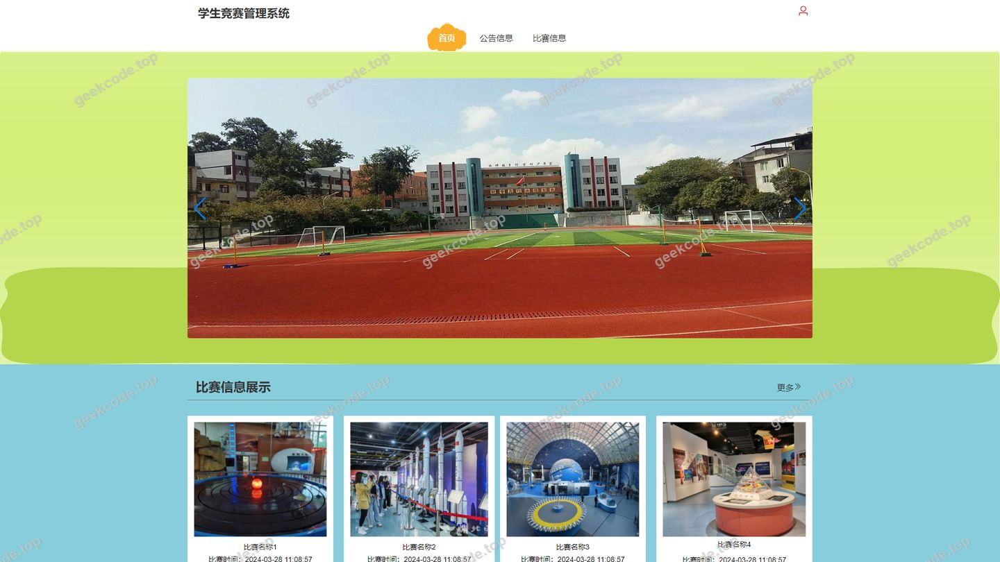
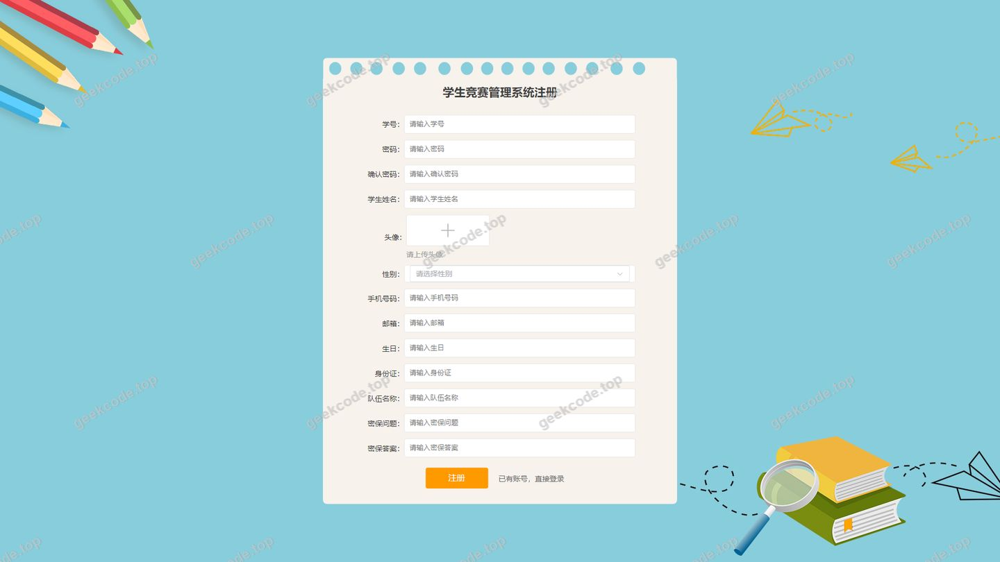
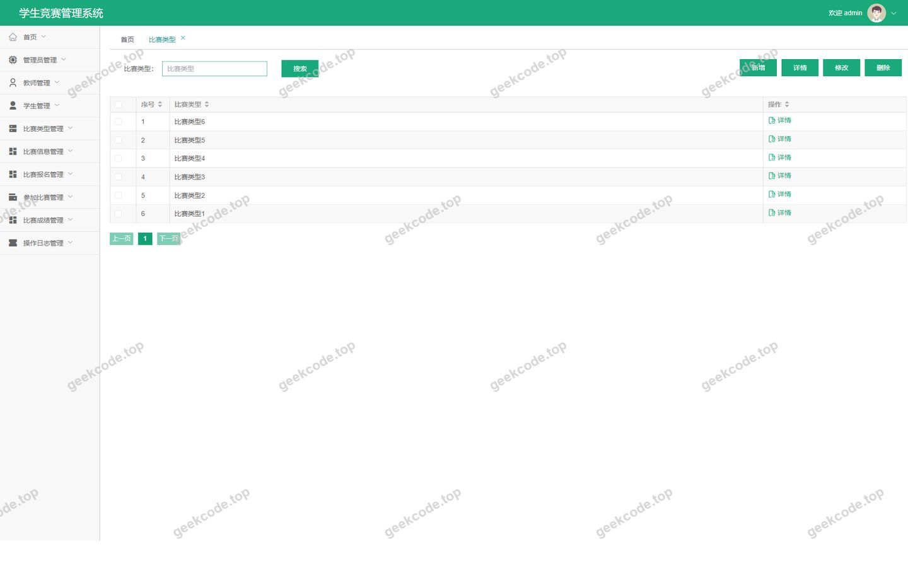
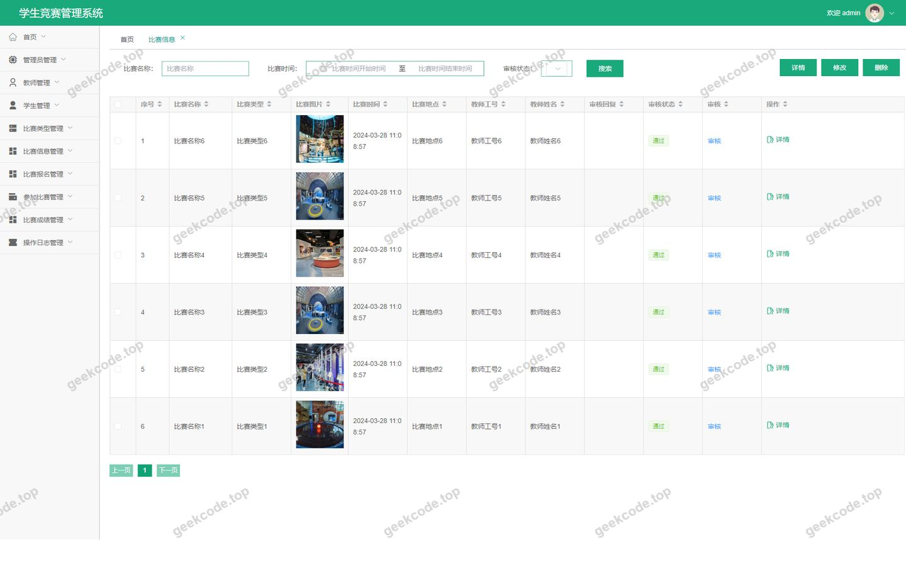
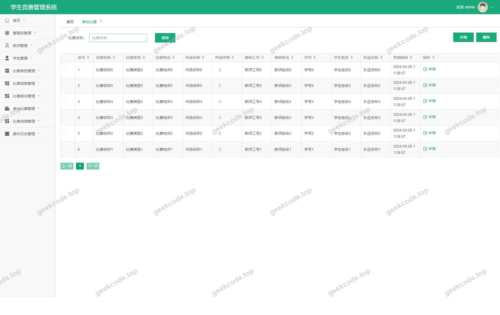
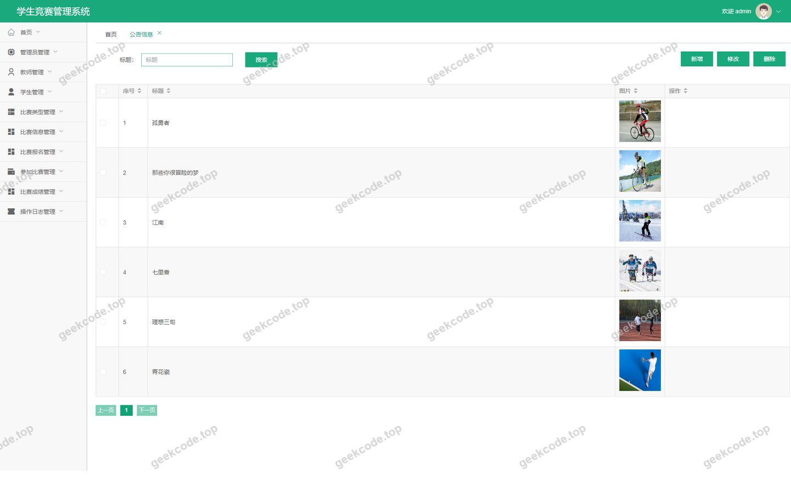
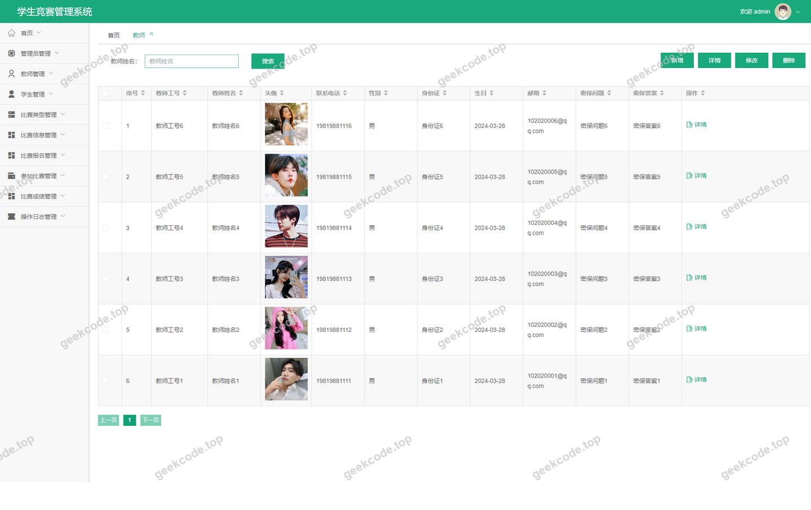
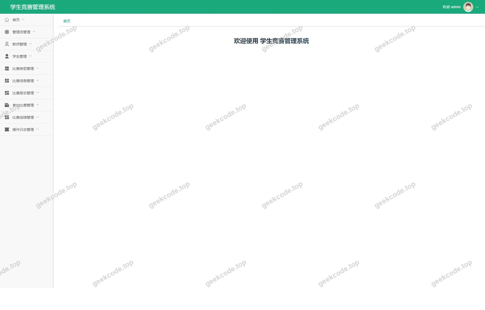
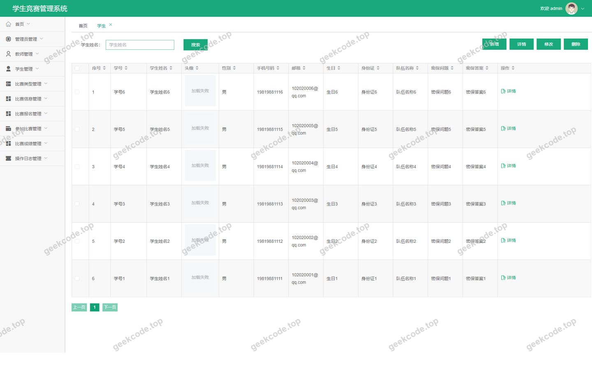

# [springboot]学生竞赛管理系统

> 🎓 **计算机毕业设计 · [springboot]学生竞赛管理系统**
>
> 本仓库只放**项目介绍 + 运行截图**（截图是站点带水印的原图，存在仓库 `images/` 里）。
>
> 👉 **完整可运行源码 / 数据库脚本 / 部署文档：[点我获取](https://geekcode.top/archives/springboot-%E5%AD%A6%E7%94%9F%E7%AB%9E%E8%B5%9B%E7%AE%A1%E7%90%86%E7%B3%BB%E7%BB%9F?utm_source=github)**
>
> 💬 咨询微信：**ir9372**　|　🌐 更多项目：[极客代码 geekcode.top](https://geekcode.top/?utm_source=github)
>
> 📌 项目详情页：<https://geekcode.top/archives/springboot-%E5%AD%A6%E7%94%9F%E7%AB%9E%E8%B5%9B%E7%AE%A1%E7%90%86%E7%B3%BB%E7%BB%9F?utm_source=github>

<table><td width="230" align="center"> <b>扫码加微信 ir9372</b></td><td valign="middle">📦 源码 = 项目介绍 + 全部运行截图 + 数据库 + 部署文档 👉 点上方任意截图，直接跳到 <b>极客代码 geekcode.top</b> 详情页</td></table>

---

<h1>[springboot]学生竞赛管理系统</h1>
<h2>项目概述</h2>

本项目旨在构建一个基于 Spring Boot 与 Vue 前后端分离架构的学生竞赛管理系统，以解决高校竞赛信息分散、报名流程繁琐及成绩管理效率低下等问题。系统核心功能涵盖比赛类型定义、比赛信息发布、学生在线报名、教师指导管理及参赛成绩记录等全流程业务。适用人群包括学校管理员、指导教师及在校学生。技术架构采用后端 Spring Boot + MyBatis-Plus + Shiro 安全框架，前端使用 Vue.js 进行页面渲染，数据库选用 MySQL，实现了数据的高效存储与安全访问控制，为校园竞赛活动提供数字化管理平台。

<h2>技术架构</h2>

本系统采用典型的前后端分离架构设计，确保系统的高内聚低耦合特性。

<strong>1. 后端架构</strong>

<ul>
<li><strong>核心框架</strong>：基于 <code>spring-boot-starter-web</code> 构建 RESTful API 服务，提供高效的数据交互接口。</li>
<li><strong>持久层</strong>：集成 <code>mybatis-spring-boot-starter</code> 和 <code>mybatis-plus</code>，利用 MyBatis-Plus 的代码生成器简化 CRUD 操作，提升开发效率；底层通过 <code>mysql-connector-java</code> 连接 MySQL 数据库。</li>
<li><strong>安全认证</strong>：引入 <code>shiro-spring</code> 实现用户身份认证（Authentication）和授权（Authorization），保障系统数据安全性。</li>
<li><strong>工具组件</strong>：使用 <code>commons-lang3</code> 处理字符串及对象操作，<code>validation-api</code> 进行参数校验，<code>protobuf-java</code> 用于特定场景下的序列化优化。</li>
</ul>

<strong>2. 前端架构</strong>

<ul>
<li><strong>视图层</strong>：采用 Vue.js 框架构建单页应用（SPA），通过路由机制区分前台用户端与后台管理端界面。</li>
<li><strong>通信机制</strong>：前端通过 Axios 或 Fetch 调用后端提供的 JSON 格式接口，实现异步数据加载与页面动态更新。</li>
</ul>

<strong>3. 数据库设计要点</strong>

<ul>
<li>基于关系型数据库 MySQL 设计，主要实体表包括：用户表（区分学生/教师角色）、比赛类型表、比赛信息表、报名表、成绩表、公告表及日志表。</li>
<li>各表之间通过外键关联，如“报名表”关联“学生ID”与“比赛ID”，确保数据的一致性与完整性。</li>
</ul>
<h2>功能模块</h2>

根据路由配置及截图所示，系统功能划分为前台用户端与后台管理端两大模块。

<h3>1. 前台用户端（学生/公众视角）</h3>

前台主要面向学生及普通访客，提供信息浏览、注册登录及个人业务办理功能。

<ul>
<li><strong>首页与信息展示</strong>：</li>
<li><code>/index/newsList</code>：查看最新公告新闻列表。</li>
<li><code>/index/bisaileixingList</code> / <code>Detail</code>：浏览比赛分类及其详情。</li>
<li><code>/index/bisaixinxiList</code> / <code>Detail</code>：查看具体比赛项目的详细信息。</li>
<li><code>/index/jiaoshiList</code> / <code>Detail</code>：浏览指导教师信息及详情。</li>
<li><strong>用户认证与管理</strong>：</li>
<li><code>/xueshengRegister</code>：学生用户注册入口。</li>
<li><code>/forget</code>：忘记密码找回功能。</li>
<li><code>/index/xueshengCenter</code>：学生个人中心，查看个人信息及我的相关数据。</li>
<li><strong>竞赛业务办理</strong>：</li>
<li><code>/index/bisaibaomingList</code> / <code>Add</code>：查看已报名比赛列表及新增报名申请。</li>
<li><code>/index/canjiabisaiList</code> / <code>Add</code>：查看参加比赛的记录及新增参赛意向。</li>
<li><code>/index/bisaichengjiList</code> / <code>Detail</code>：查询个人参赛成绩。</li>
<li><code>/index/syslogList</code>：查看部分公开的系统操作日志（视权限而定）。</li>
</ul>
<h3>2. 后台管理端（管理员/教师视角）</h3>

后台主要面向系统管理员及具备管理权限的教师，提供全局数据管理与审核功能。

<ul>
<li><strong>基础信息管理</strong>：</li>
<li><code>/bisaileixing</code>：维护比赛类型字典（如学科竞赛、体育竞技等）。</li>
<li><code>/jiaoshi</code>：管理教师账号信息及权限分配。</li>
<li><code>/xuesheng</code>：管理学生账号信息及状态。</li>
<li><code>/news</code>：发布与维护系统公告新闻。</li>
<li><strong>竞赛流程管理</strong>：</li>
<li><code>/bisaixinxi</code>：创建、编辑、删除具体的比赛项目信息。</li>
<li><code>/bisaibaoming</code>：审核学生的比赛报名申请，管理报名状态。</li>
<li><code>/canjiabisai</code>：管理实际参加比赛的人员名单及状态。</li>
<li><code>/bisaichengji</code>：录入、修改及发布比赛最终成绩。</li>
<li><strong>系统运维</strong>：</li>
<li><code>/config</code>：系统参数配置管理。</li>
<li><code>/syslog</code>：查看全量系统操作日志，用于审计追踪。</li>
<li><code>/jiaoshiCenter</code>：教师专属工作台，可能包含其指导的比赛概览。</li>
<li><code>/forget</code>：后台管理员密码重置入口。</li>
</ul>
<h2>用户角色与权限</h2>

系统基于 Shiro 框架实现细粒度的权限控制，主要涉及三类角色：超级管理员、教师、学生。

<table>
<thead>
<tr>
<th align="left">角色</th>
<th align="left">描述</th>
<th align="left">可访问的功能模块 (路由)</th>
</tr>
</thead>
<tbody><tr>
<td align="left"><strong>超级管理员</strong></td>
<td align="left">拥有系统最高权限，负责全局配置与数据维护。</td>
<td align="left"><strong>后台全部路由</strong>：<code>/jiaoshiCenter</code>, <code>/news</code>, <code>/bisaixinxi</code>, <code>/xuesheng</code>, <code>/bisaileixing</code>, <code>/canjiabisai</code>, <code>/jiaoshi</code>, <code>/syslog</code>, <code>/bisaibaoming</code>, <code>/config</code>, <code>/bisaichengji</code>, <code>/forget</code><strong>前台全部路由</strong>（通常管理员也可预览前台）：所有 <code>/index/*</code> 路径及注册/找回密码页。</td>
</tr>
<tr>
<td align="left"><strong>教师</strong></td>
<td align="left">负责指导学生参赛，审核相关报名信息，录入成绩。</td>
<td align="left"><strong>后台部分路由</strong>：<code>/jiaoshiCenter</code> (教师中心)<code>/bisaixinxi</code> (查看/发布自己相关的比赛)<code>/bisaibaoming</code> (审核所指导学生的报名)<code>/canjiabisai</code> (管理参赛名单)<code>/bisaichengji</code> (录入成绩)<code>/news</code> (发布通知)<strong>前台部分路由</strong>：<code>/index/bisaixinxiList</code>, <code>/index/bisaileixingList</code> (浏览信息)<code>/index/jiaoshiDetail</code> (查看自身资料)</td>
</tr>
<tr>
<td align="left"><strong>学生</strong></td>
<td align="left">系统的普通用户，参与竞赛报名与成绩查询。</td>
<td align="left"><strong>前台路由</strong>：<code>/index/xueshengCenter</code> (个人中心)<code>/index/bisaibaomingAdd/List</code> (报名与查看)<code>/index/canjiabisaiAdd/List</code> (参赛与查看)<code>/index/bisaichengjiList</code> (查成绩)<code>/index/newsList</code> (看公告)<code>/index/bisaixinxiList</code> (看比赛)<code>/xueshengRegister</code> (注册)<code>/forget</code> (找回密码)<strong>无后台管理权限</strong>。</td>
</tr>
</tbody></table>

<em>(注：具体菜单可见性由 Shiro 的角色标识 Role 及资源权限 Permission 动态控制)</em>

<h2>项目特色与创新点</h2>
<ol>
<li><strong>全流程闭环管理</strong>：系统覆盖了从“比赛类型定义”到“信息发布”，再到“学生报名”、“参赛确认”及“成绩录入”的完整生命周期，消除了传统纸质或 Excel 管理的断点。</li>
<li><strong>多角色协同机制</strong>：通过 Shiro 权限体系，清晰划分了管理员、教师与学生的职责边界。教师可在 <code>/jiaoshiCenter</code> 专注处理其指导范围内的业务，减轻了管理员负担。</li>
<li><strong>前后端分离体验</strong>：Vue 前端提供了流畅的单页应用体验，配合 Spring Boot 后端的 RESTful 接口，使得系统在移动端适配性及页面响应速度上优于传统 JSP 架构。</li>
<li><strong>数据安全与审计</strong>：集成 Shiro 框架保障了用户密码加密存储与会话安全；<code>/syslog</code> 模块记录了关键操作日志，为系统故障排查及安全审计提供了数据支撑。</li>
</ol>
<h2>部署环境</h2>

为确保系统稳定运行，建议部署环境如下：

<ul>
<li><strong>操作系统</strong>：Windows Server 2016+ 或 Linux (CentOS 7+, Ubuntu 18.04+)</li>
<li><strong>Java 环境</strong>：JDK 1.8 或 JDK 11 (Spring Boot 兼容版本)</li>
<li><strong>数据库</strong>：MySQL 5.7 或 MySQL 8.0 (需启用 InnoDB 引擎)</li>
<li><strong>Web 服务器</strong>：Nginx (用于前端静态资源托管及反向代理) 或 Tomcat 9.0+ (若打包为 WAR 部署)</li>
<li><strong>Node.js 环境</strong>：Node.js v14+ 及 npm/yarn (仅用于前端代码编译打包，生产环境仅需 dist 文件)</li>
<li><strong>其他依赖</strong>：Maven 3.6+ (用于后端项目构建)</li>
</ul>
<h2>五、技术特性</h2>
<ul>
<li>前后端集成部署，前端资源打包至后端 static 目录</li>
<li>使用 MyBatis-Plus 简化数据访问层开发</li>
<li>集成 Shiro 权限框架实现角色权限控制</li>
</ul>
<h2>六、功能模块截图</h2>
<h3>前台用户端</h3>
<h4>前台-首页</h4>

<h4>前台-登录</h4>

<h4>前台-学生注册</h4>

<h3>后台管理端</h3>
<h4>后台-比赛类型</h4>

<h4>后台-比赛信息</h4>

<h4>后台-参加比赛</h4>

<h4>后台-登录页</h4>

<h4>后台-公告信息</h4>

<h4>后台-教师</h4>

<h4>页面-首页</h4>

<h4>后台-学生</h4>

---

## 获取完整源码

| 项目 | 说明 |
| --- | --- |
| 项目名 | [springboot]学生竞赛管理系统 |
| 运行截图 | 本文 11 张（站点带水印原图，仓库 `images/` 目录） |
| 完整源码 | [https://geekcode.top/archives/springboot-%E5%AD%A6%E7%94%9F%E7%AB%9E%E8%B5%9B%E7%AE%A1%E7%90%86%E7%B3%BB%E7%BB%9F?utm_source=github](https://geekcode.top/archives/springboot-%E5%AD%A6%E7%94%9F%E7%AB%9E%E8%B5%9B%E7%AE%A1%E7%90%86%E7%B3%BB%E7%BB%9F?utm_source=github) |
| 咨询微信 | **ir9372**（备注：jingpin-yuanma） |
| 更多项目 | [极客代码 geekcode.top](https://geekcode.top/?utm_source=github) |

> 需要源码、部署、改配置、跑不起来等问题，加微信 ir9372 沟通，说明项目名即可。
